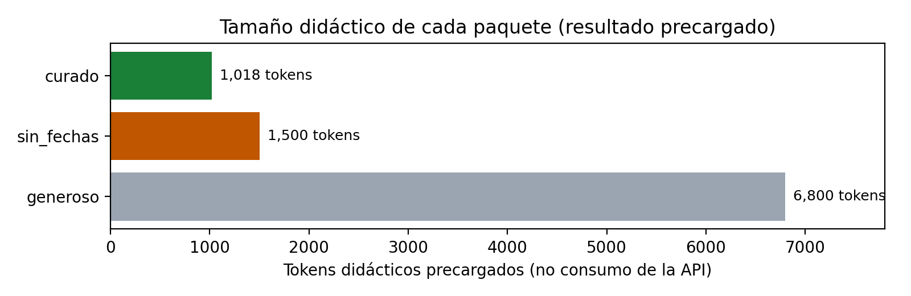

<div style="text-align: center;">

# Skill Lab 3 | Evidencia, recuperación y acciones controladas

### Mesa de contexto, aduana de acciones y reversibilidad de entradas indebidas

**Tecnológico de Monterrey** · Maestría en Inteligencia Artificial Aplicada<br>
**IA5004.10 — Sistemas multiagente** · Trimestre sept - dic 2026

**Alumno:** Oscar Alberto Ramírez Anaya · **Matrícula:** A01795438 · **Correo:** A01795438@tec.mx<br>
**Modalidad:** Individual · **Valor:** 5 % · **Fecha:** 1 de noviembre de 2026

**Entregable:** [`SkillLab3_A01795438.pdf`](./SkillLab3_A01795438.pdf) ·
**Notebook:** [`SkillLab3_A01795438.ipynb`](./SkillLab3_A01795438.ipynb)

</div>

---

## Resumen

En Distribuidora Cuauhtémoc, una captura antigua de la brecha del preventista PREV-017 puede llevar a una
decisión equivocada, y un caso duplicado o con un identificador inexistente en la bandeja genera trabajo de
corrección. Este laboratorio continúa el diseño del Construye 3 (vigencias por fuente, clases de
reversibilidad, prevención frente a compensación) en dos partes:

- **Parte A, la mesa de contexto:** comparar tres paquetes de contexto (generoso, sin fechas y curado) por
  tamaño, uso de la evidencia y vigencia.
- **Parte B, la aduana de acciones:** un enrutador **propone** la ruta de cuatro intentos de registro, un
  control independiente **decide** con reglas (existencia, duplicado, conflicto), la bandeja **conserva el
  estado** y la ruta `escalada` reserva la decisión a una persona.

Se ejecutó en modalidad **`luna_api`** (modelo `gpt-5.6-luna` vía Aula Gateway): Luna propuso las cuatro
rutas y la clase `Bandeja` autorizó la única escritura.

| Indicador | Resultado |
|---|---|
| Pruebas del instrumento | **Comprobaciones locales correctas** |
| Validador de entrega | **Sin campos pendientes** |
| Consumo real de Luna (ejecución entregada) | 1 llamada · **261 tokens de entrada / 173 de salida** |
| Propuestas de Luna que coinciden con el control | **4 de 4** |
| Entradas en la bandeja con aduana / sin aduana | **1 / 3** |
| Hallazgo principal | Luna acertó, pero no aportó nada que las reglas no tuvieran: en este caso bastaban las reglas |

## Cobertura de la rúbrica

| Criterio | Valor | Dónde se atiende en el PDF |
|---|---:|---|
| **Resultados técnicos:** cinco valores del resumen, correctos y justificados con su dato o regla de origen | 60 % | Sección 5 (tabla de los cinco resultados), con el detalle en las secciones 2.1, 3.2 y 4.1 |
| **Interpretación:** elección del paquete con evidencia numérica; clase y costo de corregir el duplicado y la tienda inexistente, separando la lista local de los supuestos de operación | 40 % | Sección 2.2 (elección y límites) y sección 4.2 (reversibilidad) |
| **Declaración de uso de IA:** herramientas, propósito y verificaciones | Requisito | Apéndice A (qué delegué, qué verifiqué, qué corregí y qué decidí) |

## Datos y modalidad

Conjunto común `skill_lab3_datos.json`, igual para todo el grupo:

| Campo | Valor | Uso |
|---|---|---|
| `dias_captura` | 32 | Antigüedad simulada de la captura que usa el paquete sin fechas |
| `tokens_curado` | 1018 | Tamaño didáctico del paquete curado (no es consumo de Luna) |
| `tienda` | T0030 | Caso válido; con T0002 forma el catálogo de tiendas |
| `producto` | P012 | Caso válido; con P002 forma el catálogo de productos |

La clave personal del Aula se introdujo solo por la entrada oculta (`getpass`); no está en el notebook, en sus
salidas, en el PDF ni en este repositorio. A Luna se enviaron únicamente los cuatro casos sintéticos.

## 1. La mesa de contexto (Parte A)

| Paquete | Fragmentos | Tokens didácticos | Uso de la evidencia | Antigüedad |
|---|---:|---:|---|---|
| generoso | 24 | 6,800 | NO: la captura decisiva quedó diluida | No la usó |
| sin_fechas | 6 | 1,500 | SÍ, pero con evidencia caduca | **32 días** |
| curado | 5 | **1,018** | SÍ: evidencia decisiva, fechada y citada | 2 días |



**Elección: curado.** Cerca del 15 % de la mesa del generoso y con la evidencia decisiva. Frente al sin
fechas la diferencia no es el tamaño (1,018 frente a 1,500) sino la vigencia: 2 días contra 32, cuando en el
Construye 3 el equipo fijó 14 días como vigencia máxima para precios de competencia. **Límites:** los conteos
están precargados, no se midió la calidad de ninguna respuesta y la fecha la aporta la simulación.

## 2. La aduana de acciones (Parte B)

Registro de ejecución literal (también en [`registro_ejecucion.json`](./registro_ejecucion.json)):

| id | Caso | Propuesta de Luna | Veredicto del control | Antes / después | Coincide |
|---:|---|---|---|---|---|
| 1 | Caso válido (T0030 · P012) | aceptada | **aceptada** | 0 / 1 | sí |
| 2 | Tienda inexistente (T9999 · P012) | rechazada_precondicion | **rechazada_precondicion** | 1 / 1 | sí |
| 3 | Duplicado (T0030 · P012) | rechazada_duplicado | **rechazada_duplicado** | 1 / 1 | sí |
| 4 | Conflicto con promoción (T0002 · P002) | escalada | **escalada** | 1 / 1 | sí |

La propuesta no es un permiso: el control revisa cada intento con los datos originales, y si Luna hubiera
propuesto otra ruta el registro conservaría ambos valores con `coincide = False`.

## 3. Ruptura y reversibilidad

Sin precondiciones, la bandeja admitió **3 entradas; 2 indebidas** (la tienda fantasma y el duplicado).

| Entrada | Clase | Lo ejecutado | Supuesto de operación real |
|---|---|---|---|
| Duplicado | `reversible_con_costo` | Tupla en memoria; se borra sin costo | Se asigna dos veces al preventista: fusionar historial, cancelar la visita repetida; si ya hubo doble visita o reabasto, compensar |
| Tienda inexistente | `reversible_con_costo` | Tupla en memoria; se borra sin efecto | No se puede atender, pero contamina conteos: rastrear el origen del ID, darlo de baja y recalcular indicadores |

Ambas serían `irreversible` si hubieran disparado una acción externa (pedido o aviso), lo cual aquí no ocurre.
El duplicado es el que más cuesta corregir: es verosímil y puede ejecutarse dos veces.

## 4. Los cinco resultados

| # | Resultado | Valor | Origen |
|---:|---|---|---|
| 1 | Tokens didácticos del paquete curado | 1018 | `tokens_curado` del JSON |
| 2 | Días de la captura sin fechas | 32 | `dias_captura` del JSON |
| 3 | Veredicto de la llamada 2 | rechazada_precondicion | Regla 1: T9999 no está en el catálogo |
| 4 | Veredicto de la llamada 4 | escalada | Regla 3: T0002/P002 válidos y nuevos, con conflicto |
| 5 | Entradas indebidas sin precondiciones | 2 | 3 entradas sin aduana menos 1 legítima |

## 5. Conclusiones

- **Contexto:** seleccionar por vigencia antes que por tamaño; el sin fechas casi iguala al curado en tamaño,
  pero con evidencia de 32 días.
- **Control:** el duplicado es el más caro de corregir y lo previene la regla de duplicados.
- **Orquestación:** Luna propuso, la `Bandeja` autorizó y el conflicto se reservó a una persona por ser un
  juicio comercial. En este caso bastaban las reglas: 434 tokens por un resultado que `sin_api` obtiene gratis.

## Notebook

- **Visualizar en GitHub:** [`SkillLab3_A01795438.ipynb`](./SkillLab3_A01795438.ipynb)
- **Visor enriquecido (nbviewer):** https://nbviewer.org/github/oscar-ramirez-anaya/SkillLab3_A01795438/blob/main/SkillLab3_A01795438.ipynb
- **Descargar (raw):** https://raw.githubusercontent.com/oscar-ramirez-anaya/SkillLab3_A01795438/main/SkillLab3_A01795438.ipynb

El notebook está ejecutado con salidas en modalidad `luna_api`: las celdas DECISIÓN (`PAQUETE_ELEGIDO`,
`POR_QUE`, `REVERSIBILIDAD`, `JUSTIFICACIONES`, `CONCLUSIONES`, `DECLARACION_IA`) están completas.

## Estructura del repositorio

```
.
├── SkillLab3_A01795438.pdf       # Entregable para Canvas (14 páginas)
├── SkillLab3_A01795438.ipynb     # Notebook del laboratorio, completado y ejecutado con salidas
├── skill_lab3_datos.json         # Conjunto común del laboratorio
├── orquestacion_aula.py          # Adaptador del enrutador (reglas locales o Luna), sin cambios
├── exportar_pdf.py               # Exportador del curso, sin cambios
├── registro_ejecucion.json       # Registro, consumo y resultados de la ejecución entregada
├── figuras/
│   └── paquetes_contexto.png     # Gráfica de los tres paquetes
├── reporte/
│   ├── reporte_tpl.html          # Fuente del PDF (portada, índice, secciones, apéndice, glosario)
│   ├── logo_tec.png              # Logo de la portada
│   └── generar_pdf.py            # Render con Chrome headless, índice paginado y pie de página
├── README.md
└── .gitignore
```

## Reproducir

**Notebook.** Requiere Python 3 con `pandas` y `matplotlib`. Coloca el notebook, `skill_lab3_datos.json`,
`orquestacion_aula.py` y `exportar_pdf.py` en la misma carpeta y ejecuta en orden. Con `MODO = "luna_api"` y
`AUTORIZAR_CONSULTA = True` el notebook pide la clave personal del Aula en una entrada oculta; con
`MODO = "sin_api"` corre sin tokens y obtiene los mismos veredictos.

**PDF.** Requiere Google Chrome y los paquetes `pypdf` y `reportlab`:

```bash
cd reporte
python3 generar_pdf.py
mv SkillLab3_A01795438.pdf ..
```

## Referencias

- Hunter, J. D. (2007). Matplotlib: A 2D graphics environment. *Computing in Science & Engineering, 9*(3), 90–95. https://doi.org/10.1109/MCSE.2007.55
- Liu, N. F., Lin, K., Hewitt, J., Paranjape, A., Bevilacqua, M., Petroni, F., & Liang, P. (2024). Lost in the middle: How language models use long contexts. *Transactions of the Association for Computational Linguistics, 12*, 157–173. https://doi.org/10.1162/tacl_a_00638
- McKinney, W. (2010). Data structures for statistical computing in Python. En *Proceedings of the 9th Python in Science Conference* (pp. 56–61). https://doi.org/10.25080/Majora-92bf1922-00a
- Tecnológico de Monterrey. (2026). *Skill Lab 3: Evidencia, recuperación y acciones controladas* [Notebook y conjunto común de datos; material del curso IA5004.10 Sistemas multiagente]. Experiencia21.

---

*Datos: conjunto común didáctico del caso Distribuidora Cuauhtémoc. La bandeja es una lista en memoria; no se
modificó ningún sistema empresarial.*
